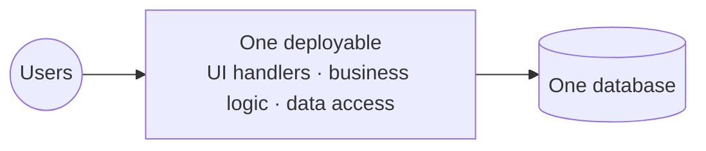
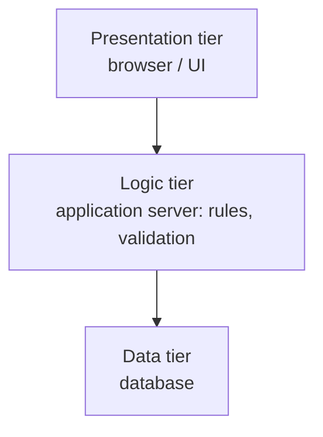
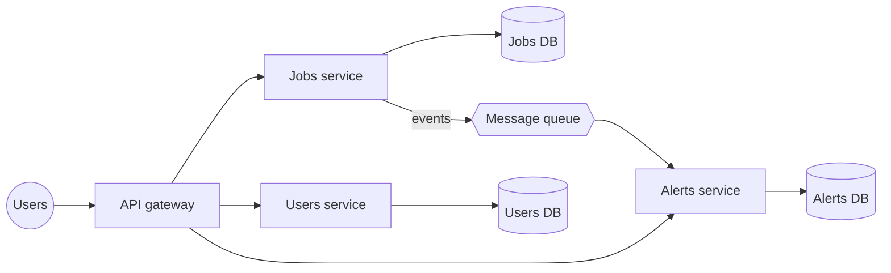
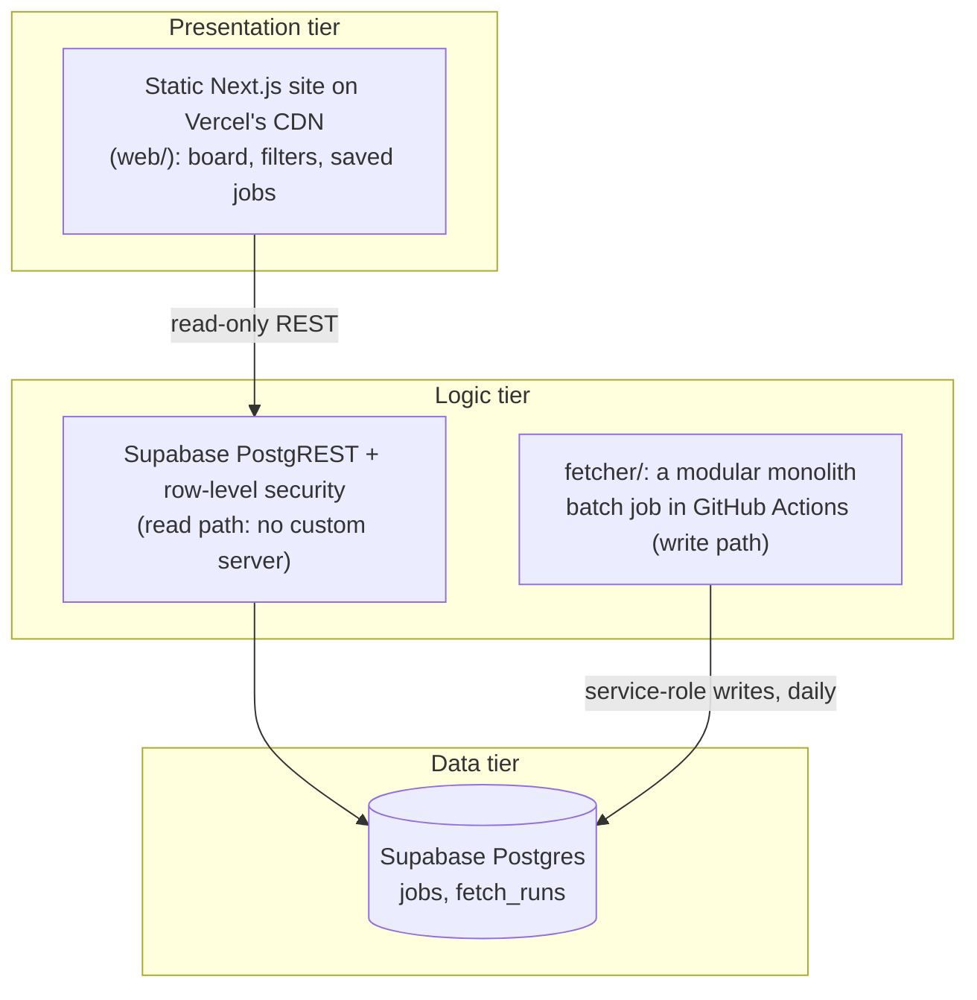

# Architecture styles: monolith, n-tier, microservices

This document explains three common ways to structure software, how they compare, and where dresden/jobs fits. The concrete design of this project is in `docs/architecture.md`.

The three styles answer two different questions, which is the first thing to get right:
- **Monolith vs microservices** is about **deployment**: is the backend built and released as one unit, or as many independent services?
- **N-tier** is about **layering**: which responsibilities sit in which layer (presentation, logic, data), and which layer may talk to which?

So they aren't three exclusive options. A monolith is usually layered (n-tier inside one deployable), and each microservice is often layered internally too.

## 1. Monolith

**What it is:** the whole application (user interface handlers, business logic, data access) is built, tested and deployed as **one unit**, typically one process talking to one database.

**Strengths:**
- **Simple to build, run and reason about:** one codebase, one build, one deploy, one log.
- **Fast:** calls between parts are function calls, not network calls.
- **Easy consistency:** one database transaction can cover everything.
- **Easy refactoring:** the compiler and tests see the whole system.

**Weaknesses (they appear with size, not on day one):**
- **Scaling is all-or-nothing:** to scale one hot part, you run more copies of everything.
- **One deploy for every change:** a small fix ships the whole application, and one bad change can take everything down.
- **Coupling grows over time:** without discipline, modules reach into each other ("big ball of mud").
- **Team bottleneck:** many teams in one codebase step on each other.

**Modular monolith:** a monolith with strict internal boundaries (modules with clear interfaces, no reaching into another module's data). It keeps most of the monolith's simplicity while preparing for a later split. Most experienced teams start here.

## 2. N-tier (layered) architecture

**What it is:** the system is split into **layers (tiers)**, each with one responsibility. A layer talks only to the layer directly below it. "Tier" often also means a separate machine or process; "layer" can be purely logical inside one program.

The classic **3-tier** version:

| Tier | Responsibility | Example |
|---|---|---|
| Presentation | Show data, take input | Web page, mobile app |
| Logic / application | Business rules, validation, orchestration | API server |
| Data | Store and query data | Postgres |

**Variants:**
- **2-tier:** the client talks to the database directly (classic client–server).
- **4+-tier:** more layers, for example a separate API gateway, cache or integration tier.

**Strengths:**
- **Separation of concerns:** UI changes don't touch the database, and vice versa.
- **Security by layering:** the database is only reachable from the logic tier.
- **Tiers can scale and be hosted separately:** e.g. a CDN for presentation, a cluster for logic, a managed database.

**Weaknesses:**
- **Extra hops:** every request passes every layer, even for simple reads.
- **"Pass-through" layers:** logic tiers that only forward data add code without value.
- **Still one deployable per tier:** it doesn't by itself solve team or scaling problems inside a tier.

## 3. Microservices

**What it is:** the backend is split into **many small services**, each owning one business capability (e.g. "jobs", "users", "notifications"). Each service:
- is deployed independently
- **owns its own data**; no shared database
- talks to the others over the network (HTTP/REST, gRPC, or messages via a queue)

**Strengths:**
- **Independent deploys:** one team ships its service without coordinating a big release.
- **Independent scaling:** only the hot service gets more instances.
- **Fault isolation:** if done well, one service failing doesn't stop the rest.
- **Technology freedom per service.**
- **Fits large organisations:** one team per service, matching Conway's law ("systems mirror the communication structure of the organisation").

**Weaknesses (they are real and immediate):**
- **Distributed-systems problems:** network failures, timeouts, retries, partial failures, versioned APIs.
- **No simple transactions across services:** consistency needs sagas or events, and data is eventually consistent.
- **Operational cost:** service discovery, API gateway, centralised logging, distributed tracing, monitoring, one CI/CD pipeline per service, often containers and Kubernetes.
- **Harder to test and debug** end to end.
- **The "distributed monolith" trap:** services that must be deployed together or share a database get the costs of both styles and the benefits of neither.

## 4. Side by side

| | Monolith | N-tier | Microservices |
|---|---|---|---|
| Main question | How many deployables? (one) | How are responsibilities layered? | How many deployables? (many) |
| Deploy unit | Whole app | One per tier | One per service |
| Data | One database | Data tier | One database **per service** |
| Communication | Function calls | Calls between adjacent layers | Network (HTTP, gRPC, messages) |
| Scaling | Whole app | Per tier | Per service |
| Consistency | Easy (transactions) | Easy within the data tier | Hard (eventual consistency) |
| Operational cost | Low | Low–medium | High |
| Fits | Small–medium teams, early products | Most business apps | Many teams, large scale, clear domains |
| Typical failure | Big ball of mud | Pointless pass-through layers | Distributed monolith |

**Rule of thumb used by most senior architects:** start with a **well-structured (modular) monolith**, often layered n-tier inside. Split out a service only when there is a concrete reason that justifies the cost: one part needs very different scaling, separate teams keep blocking each other, or a part needs a different release cadence or technology.

## 5. Where dresden/jobs fits

Our system is a **3-tier architecture** with a **modular monolith** as its only custom backend, plus **managed services** for everything else. It isn't microservices.

**How each style shows up:**
- **N-tier (3-tier):** presentation (static site) → logic (PostgREST enforcing read-only access via RLS; the fetcher holding the business rules) → data (Postgres). The browser never touches the database directly; it goes through the REST layer, which only allows reading.
- **Monolith:** the fetcher is **one deployable** (one Python program, one test suite, one GitHub Action). Inside, it's a **modular monolith** with clear modules: `sources/` (one module per source behind the same `fetch()` interface), `classify`, `terms`, `availability` (pure functions), `store` (persistence behind `get_store()`). The website is also one deployable.
- **Not microservices:** there's no separate jobs, users or alerts service, no service-to-service network calls and no per-service databases. The only "split" is between **read** and **write**: the website reads, the fetcher writes, both through the same database. This is a light form of the CQRS pattern (separate read and write paths), not microservices.

**Why this is the right choice now:**
- **One person and a few agents build it.** Microservices pay off for many teams, not one.
- **Load is tiny and read-heavy.** A CDN plus a read-only REST API handles 5,000 users on free tiers (`docs/capacity.md`). Nothing needs independent scaling.
- **Consistency matters more than independence.** One database means one place of truth for "which jobs are open".
- **Operational cost:** zero servers to run, patch or monitor; microservices would add a gateway, monitoring, tracing and several pipelines for no user benefit.

**When we would change:**

| Trigger | Likely change | Still not microservices? |
|---|---|---|
| 100+ jobs or > 2.5 GB/month egress | Serve the job list as a static file from the CDN (rebuilt after each fetch) | Yes, same shape |
| Logins | Add a small server tier (Next.js server routes on Vercel) for sessions in HttpOnly cookies, using Supabase Auth | Yes, a 3-tier app with a real logic tier |
| Email alerts for new jobs | A separate scheduled job (or queue consumer) that sends emails via a managed provider | First genuine separate service, but triggered by data, not a microservice platform |
| Several cities with different sources and teams | Split the fetcher per region behind the same `store` interface | Possibly: the first real case for independent services |

The modular boundaries inside the fetcher (`sources/`, `availability`, `store`) are what make each of these steps cheap later. That's the practical value of a **modular** monolith.
