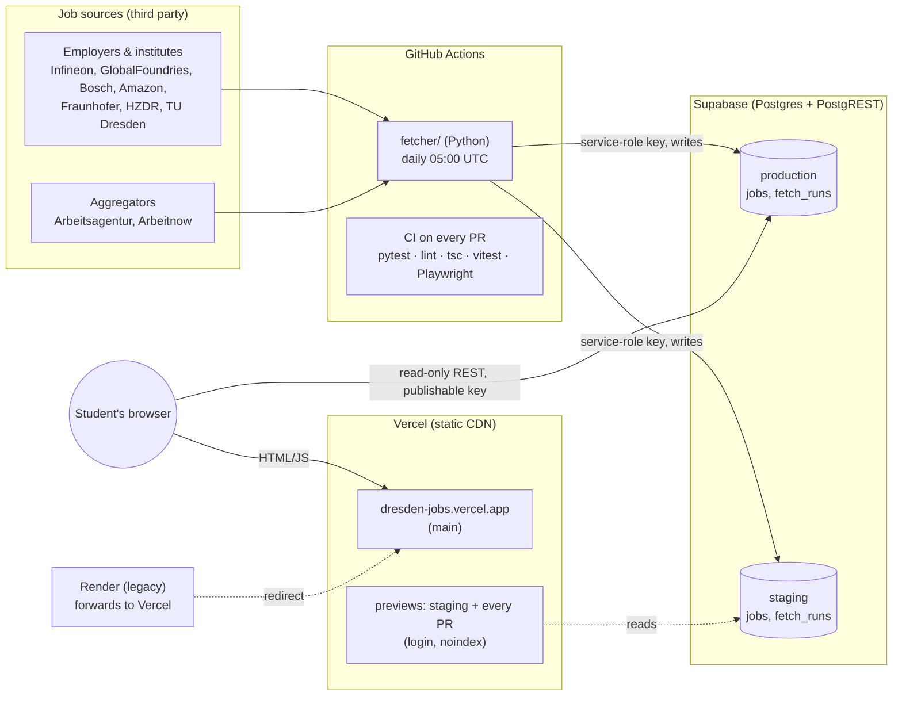
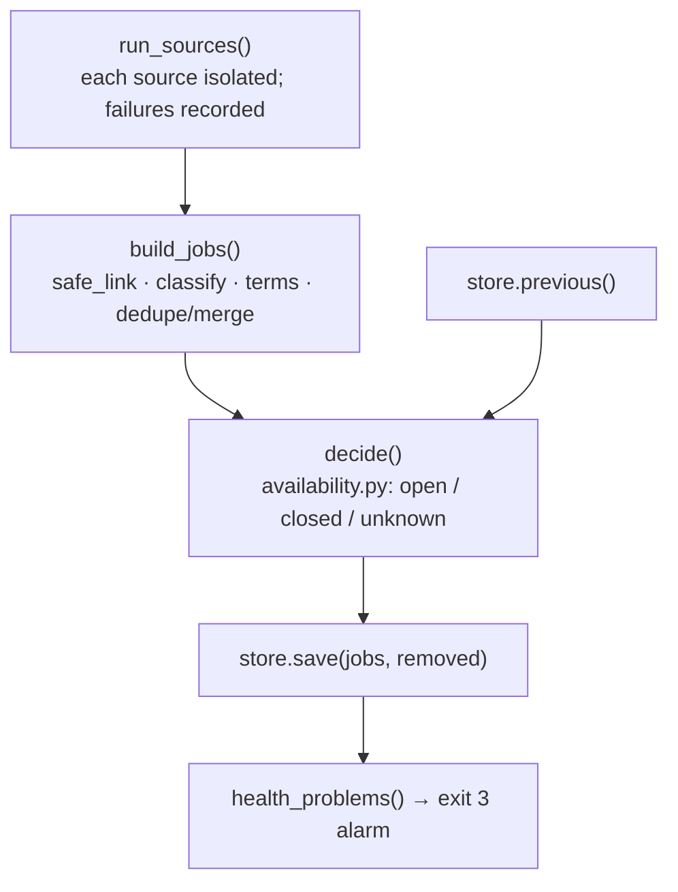
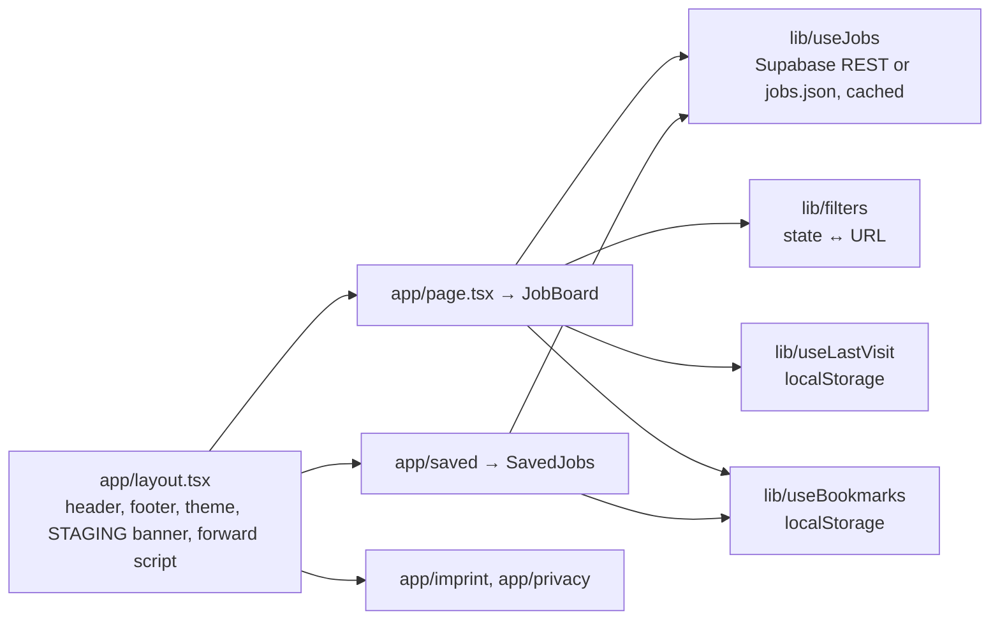

# Architecture

dresden/jobs is a job board for student roles (Werkstudent, internship, thesis) in AI, data and computer science around Dresden. This document describes how the system is built and why. For day-to-day commands see `CLAUDE.md`; for the team process see `docs/workflow.md`.

Last updated: 2026-10-30 (after sprint 3).

Architecture style in one line: a **3-tier** system (static site → read-only REST → Postgres) whose only custom backend is a **modular monolith** (the fetcher), with managed services for hosting, data and CI. Not microservices. `docs/architecture-styles.md` explains the three styles and why.

## 1. System overview

Three properties define the design:
- **Static site, no server.** Next.js is exported to static files and served from Vercel's CDN. All job rendering happens in the browser, which reads the data directly from Supabase with a public, read-only key.
- **One writer.** Only the fetcher writes to the database, once a day, from a GitHub Action holding the service-role key. Nothing a visitor does can change shared data.
- **Free tiers only.** Vercel Hobby, Supabase Free (two projects), GitHub Actions. `docs/capacity.md` shows this holds for 5,000 users at today's size.

## 2. Components

| Component | Where | Responsibility |
|---|---|---|
| Fetcher | `fetcher/` | Pull postings from 9 sources, classify, merge duplicates, decide which jobs are still open, save |
| Database | Supabase (`supabase/schema.sql`) | Two tables, RLS: anyone reads, only the service role writes |
| Website | `web/` (Next.js 16 static export) | Board, filters, saved jobs, legal pages; all client-side |
| CI/CD | `.github/workflows/`, Vercel Git integration | Tests on every PR; daily fetch; deploys on push |
| Legacy forward | `render.yaml`, `web/lib/legacyHost.ts` | Old Render address forwards to Vercel, carrying bookmarks (remove after 2027-01-31) |

### 2.1 Fetcher pipeline (`fetcher/main.py`)

1. **Sources** (`fetcher/sources/*.py`). Each module exposes `NAME` and `fetch()`; parsing is split into pure `parse*()` functions tested offline against `fetcher/tests/fixtures/`. Order in `SOURCES` matters: employers and institutes first, aggregators last, because the first link of a merged job is its "Apply now" button.
   - Employer feeds (Eightfold, Workday, SmartRecruiters, amazon.jobs) list every role; full postings are fetched only for student-looking titles.
   - Page caps raise instead of truncating, and a feed that ends before its reported total fails the source, so a cut-off list can never look like closed jobs.
2. **Links** (`safe_link`, `LINK_HOSTS`). Only `https://` URLs on each source's known host are accepted. A posting with any other link is skipped and counted; any rejection raises the alarm.
3. **Classification** (`classify.py`). Type (Werkstudent/internship/thesis) from title and tags; field (AI/ML, data, software, embedded, other CS) from title and tags, with strict rules for description-only evidence. HiWi, Ausbildung, PhD and senior roles are excluded on purpose.
4. **Terms** (`terms.py`). Hours per week and pay, extracted only when a posting states them; never guessed. Full-time boilerplate, office hours, breaks and overtime are ignored.
5. **Dedupe and merge.** `job_id()` = sha1 of normalized title and company. The first (highest-priority) posting keeps snippet, dates, language, hours and pay; later copies only add their link or fill empty text fields. Arbeitsagentur's cut-off GlobalFoundries titles merge into the employer's job (`truncated_twin`).
6. **Availability** (`availability.py`, pure). See section 4.
7. **Save** (`store.py`). `SupabaseStore` upserts by id, deletes closed ids and writes a `fetch_runs` row. Without Supabase variables, `JsonFileStore` writes `web/public/jobs.json` for local development.
8. **Health alarm.** A source that failed, returned nothing, had links rejected, lost all its jobs, or tripped the removal guard makes the run exit with code 3; GitHub emails the owner.

### 2.2 Website (`web/`)

- **Static export** (`output: "export"`, `trailingSlash: true`). No server features: no route handlers, server actions, rewrites or image optimisation.
- **Data:** `useJobs` loads the job list and the latest `fetch_runs` row once per page load and caches it module-wide. `NEXT_PUBLIC_*` values are inlined at build time, so a changed setting needs a redeploy.
- **State lives in the URL** (`lib/filters.ts`): search, type, field, language, remote, fresh, hours, since, sort and the open job (`?job=`). Component state is the source of truth and is mirrored to the URL after 250 ms.
- **State in the browser only** (no accounts, no cookies): bookmarks (`dsj:bookmarks:v1`, whole job objects so closed jobs still show), theme (`dsj:theme`), last visit (`dsj:lastVisit`: newest job seen and visit times, rolled forward after 30 minutes).
- **Design system:** CSS variables in `app/globals.css` exposed as Tailwind tokens; dark mode via a `.dark` class set before paint.
- **Legal pages:** operator name, address and email come from Vercel environment variables (`NEXT_PUBLIC_OPERATOR_*`), never from the repo. The pages are noindex.

## 3. Data model (`supabase/schema.sql`)

**`jobs`**, one row per job (camelCase in the app, snake_case in the database; `COLUMNS` in `store.py`, `types.ts` and `JOB_SELECT` in `useJobs.ts` must stay in sync):

| Column | Meaning |
|---|---|
| `id` | sha1 of normalized title and company; changing the normalisation changes ids (resets "New" and orphans bookmarks) |
| `title`, `company`, `location`, `remote` | from the first posting |
| `type`, `types`, `fields`, `english_friendly` | classification |
| `posted_at`, `deadline` | as stated by the source |
| `first_seen` | first day the job appeared ("New" badge, "new since your last visit") |
| `last_seen` | last day the job was **confirmed open** |
| `links` | JSON list of `{source, url}`; the first is "Apply now" |
| `snippet` | up to 700 characters of the description |
| `hours_min`, `hours_max`, `pay_amount`, `pay_unit` | only when the posting states them |

**`fetch_runs`**: one row per daily run with the job count and per-source status (`ok`, `count`, `error`, `rejected`, `links: {open, closed, unknown}`). It is public, so errors pass through `redact()`, which strips URL query strings.

**Access:** row-level security on both tables. `anon` and `authenticated` may only `select`; insert, update and delete are revoked. The fetcher uses the service-role key, which bypasses RLS.

## 4. Availability: showing only open jobs (`fetcher/availability.py`)

Every link of every job gets a state, then every job a verdict.

| Situation | Link state |
|---|---|
| Listed today, complete feed (employer, institute) | open |
| Listed today, aggregator (`FEED = "partial"`) | open, unless its own check says closed |
| Not listed, but the URL now belongs to another job | closed (moved) |
| Not listed, but still in the raw feed (not classified today) | unknown |
| Not listed, source failed or skipped | unknown |
| Not listed, aggregator | its check: Arbeitsagentur detail API (200/404), Arbeitnow page status (200/410) |
| Not listed, complete feed that worked | closed |

**Verdict:** any open link keeps the job (`last_seen` = today). The employer is authoritative: if a job's first link is from a complete feed and closed, the job closes even if an aggregator still lists a copy. All links closed removes the job. Otherwise the job is unconfirmed and stays for 2 days after it was last confirmed open.

**Guard:** if a source's own closed links would remove at least 3 and more than half of its jobs in one run, those jobs stay and the alarm fires. A real mass closure is approved once by running "Update jobs" with `accept_removals=<Source>`. A source losing all its jobs in one run also raises the alarm.

## 5. Environments and delivery

| | Development | Staging | Production |
|---|---|---|---|
| Code | feature branch | `staging` branch | `main` branch |
| Site | `npm run dev` / local build | Vercel preview (login, noindex, STAGING banner) | dresden-jobs.vercel.app |
| Database | staging Supabase | staging Supabase | production Supabase |
| Who writes data | developer's local fetch (staging only) | daily Action + manual runs | **only** the scheduled/dispatched Action with `ALLOW_PRODUCTION_WRITE=1` |

**Flow:** feature branch → PR into `staging` → release PR `staging` → `main` (merge commit). Both branches are protected: a PR with "Fetcher tests" and "Website checks" green, admins included, no force-push.

**Guards that don't rely on discipline:**
- `main.py` refuses to write to the production project without `ALLOW_PRODUCTION_WRITE`, so local runs can't touch production.
- Separate secrets per database, no fallback between them.
- Schema changes are applied to staging first and to production right before the release merge (`/release` step 7).

**CI** (`ci.yml`): pytest; web lint, type-check, vitest, and Playwright smoke tests against a static build with fixture data. Actions are pinned to commit SHAs; Python dependencies install from a hashed lock (`fetcher/requirements.lock`).

**Daily fetch** (`update-jobs.yml`): runs the tests, then fetches into both databases (matrix). Manual dispatch defaults to staging.

**Rollback:** the site rolls back instantly in Vercel by promoting the previous deployment; the fetcher by reverting the merge. Schema changes are additive and nullable, so old code keeps working.

## 6. Security model

- **No secrets in the browser.** The site only holds the publishable key; RLS limits it to reading.
- **Third-party data is untrusted.** Links pass `safe_link`; text is rendered by React (no HTML injection); the highest-priority source wins merges, so an aggregator copy can't change an employer's job.
- **Headers** (`web/vercel.json`): `Content-Security-Policy` with `frame-ancestors 'none'`, `base-uri`, `object-src`, `form-action`; `X-Frame-Options: DENY`; `nosniff`; strict referrer policy. HSTS comes from Vercel.
- **Supply chain:** SHA-pinned actions, hashed Python lock, `npm audit` clean, PRs from forks get no secrets.
- **Privacy:** no accounts, no cookies, no tracking. Browser storage stays on the device. The privacy page lists every key.
- **Red team:** Kevin attacks once per sprint before the release; results in `docs/security.md`.

## 7. Key decisions

| Decision | Why | Revisit when |
|---|---|---|
| Static export + client-side data | Free, fast from the CDN, nothing to run or patch | Logins (sessions need a server for HttpOnly cookies) |
| Supabase REST with the public key | No backend to write; RLS enforces read-only | Egress > 2.5 GB/month or 100+ jobs → serve the list from the CDN (`docs/capacity.md`) |
| Daily batch fetch in GitHub Actions | Sources change slowly; one writer keeps the model simple | Students need fresher data |
| Employer feeds before aggregators | The employer's posting is the source of truth for links, text, pay and closure | — |
| Only open jobs, with a guard | Stale jobs waste students' time; a broken source must never wipe the board | — |
| No accounts | Browser bookmarks cover the need; accounts add GDPR, security and support cost | Students ask for cross-device sync (preconditions in `docs/backlog.md`) |
| Vercel over Render | Free previews per branch/PR and 100 GB bandwidth vs 5 GB | Commercial use (Hobby is non-commercial) |
| Two Supabase projects | Staging data can never touch production | — |

## 8. Known limits

- **Employer closures aren't remembered:** an exact-title aggregator copy can reappear the next day as its own job (backlog, needs a tombstone table).
- **Moved links count as closures** in the guard wording and stats (backlog).
- **Every visit queries Supabase:** fine at today's size; the CDN switch point is in `docs/capacity.md`.
- **Free plans:** no Supabase backups (the data is rebuilt daily), projects pause after 7 days without writes (the daily fetch prevents it), Vercel Hobby is non-commercial.
- **Render forward** is temporary and goes after 2027-01-31.
